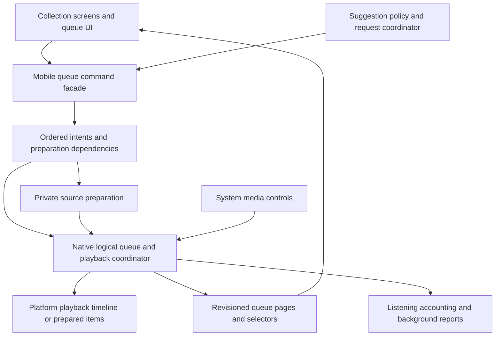

# Queue review and rewrite plan

Reviewed: 2026-10-15. The findings below describe the original RNTP implementation and replacement components before the rewrite.

Current status: the user subsequently authorized the complete migration. The rewritten command layer, native queue/content/control guards, metadata retirement, failed-read recovery, authentication/runtime composition, full playlist loading and UI/startup switch are implemented. RNTP has been removed. [QUEUE_BEHAVIOR.md](QUEUE_BEHAVIOR.md) describes current rules; [AUDIO_MIGRATION_PROGRESS.md](AUDIO_MIGRATION_PROGRESS.md) records checks and remaining validation. Fully lazy queue UI, large queue preparation/reconciliation measurements, physical devices and the real iOS React Native host remain open.

## Recommendation

Add a complete rewrite of the mobile queue layer as a prerequisite to the runtime/UI migration. Replace AudioPlayerService.useQueue and its screen-level coordination rather than translate its RNTP calls one by one.

Keep the replacement player's native logical queue as the single authority. Its canonical order, playback order, occurrence identifiers, revision checks and native transitions are useful foundations. They still need the corrections and extensions below. A rewrite of every native reducer from scratch is not justified by this review.

The new mobile adapters are building blocks, not a finished queue implementation. Their current tests do not cover all the interleavings found here. Include their ordering, observation and metadata issues in the rewrite chapter before connecting them to the UI.

## What the current app actually does

The full list lives in React state. A parallel set of refs exposes that list and its selected index to asynchronous callbacks. RNTP receives the selected track and, sometimes, one upcoming track. A timer populates that upcoming track. Native events, UI commands and remote controls then try to keep the React index aligned with RNTP's shorter queue.

AudioPlayerService also owns cache resolution, shuffle restoration, repeat rules, suggestions, listening sessions, error advancement and event subscriptions. MusicProvider broadcasts the hook's combined result to its consumers. Album, playlist and search screens participate in starting playback through effects triggered by changes to the React queue.

This creates several representations of the same state, with no single transaction covering them. Many of the flags compensate for that split ownership.

## Findings in the active RNTP implementation

Locations below refer to the reviewed working tree. Consequences are inferred from the source branches and asynchronous ordering; these are not device reproductions. High priority means incorrect playback, lost queue edits or account isolation risk. Medium priority means recovery, usability or efficiency gaps.

| Finding | Priority | Evidence and consequence |
| --- | --- | --- |
| Q01. Competing queue authorities | High | [AudioPlayerService](src/services/AudioPlayerService.ts), lines 97–127, 241–275 and 402–448: React owns the list/index while RNTP owns the currently loaded items. nextTrackQueuedRef is a Boolean, not an association between a queue occurrence, native item and revision. Changes can invalidate that association without changing the flag. |
| Q02. Shuffle restoration loses edits and merges duplicate songs | High | AudioPlayerService, lines 640–675: enabling shuffle copies originalQueueRef; disabling it restores that old array. A song appended while shuffled is lost; a song removed while shuffled can reappear. findIndex compares recording id, so two occurrences of the same recording cannot be distinguished. Current selection/order also changes before RNTP's prequeued item is reconciled. |
| Q03. Removing an upcoming track does not remove its native item | High | AudioPlayerService, lines 597–620: removing a noncurrent row changes only React state/index. If B was prequeued after A, removing B leaves it in RNTP. When B starts, PlaybackActiveTrackChanged assumes the next React row is playing and can label/report C while B is audible. |
| Q04. Active removal violates the settled requirement | High | AudioPlayerService, lines 609–616: removing the selected row stops/resets playback and sets the selection to missing. The user has already required continuing with the next surviving entry. The replacement native reducers implement that successor policy; the active hook does not. |
| Q05. Replacement and selection are separate operations spread across screens | High | AudioPlayerService, lines 546–560, changes React state without replacing RNTP's items. [AlbumViewer](src/pages/AlbumViewer/AlbumViewer.render.tsx), lines 82–124, [PlaylistViewer](src/pages/PlaylistViewer/PlaylistViewer.render.tsx), lines 114–158, and [Search](src/pages/Search/Search.render.tsx), lines 120–144, use shouldPlayFromStart effects to issue a second command after a render. Between the two steps, metadata and audio can refer to different queues. Playback startup depends on screen effect timing and lifetime. |
| Q06. Pause and Play bypass transition serialization | High | AudioPlayerService, lines 135–165 and 579–589: reset/add/play transitions use pendingPlayerOperationsRef, but ordinary Play/Pause call RNTP directly. Pause during a pending cache lookup does not cancel the candidate; its later TrackPlayer.play can resume playback. A seek queued behind source work can also be delayed by that work. |
| Q07. Automatic advancement guesses the active occurrence | High | AudioPlayerService, lines 498–535: queue-ended and error events call the same playNext path; active-track-changed increments a React index instead of identifying the native occurrence supplied by the event. isAdvancingRef gates queue-ended/error handlers, but does not establish one order with manual Next and native active-track changes. Rapid controls and native events can therefore disagree about which transition already happened. |
| Q08. Queue ownership is not cleared on logout/account change | High | The hook reads getToken but has no account lifecycle effect. [AuthContext](src/hooks/AuthContext.tsx), lines 49–69, changes login state/storage without stopping the player. MusicProvider sits above the navigation stacks. Existing queue entries retain bearer headers and playback/reporting can outlive the originating login. The new authentication coordinator is not wired into this active path. |
| Q09. Suggestions have no explicit request or ownership model | Medium | AudioPlayerService, lines 287–327 and 329–360: a pending request captures playbackRequestRef but starting another suggestion request does not replace that marker. Concurrent Next actions can start duplicate HTTP work; sufficiently overlapping completions can append the batch more than once. suggestedQueueStartIndex describes an array position rather than entry provenance, and shuffle resets it. An empty response does not explicitly settle a terminal state; failure resets playback. Suggestions only load one batch before stopping unless another action resets the marker. |
| Q10. Cache prefetch can change a different occurrence | High | AudioPlayerService, lines 214–239: prefetchTrackAtIndex captures a track, awaits filesystem work, then writes the resulting file URL into whichever row now occupies the numeric index. There is no queue/session/occurrence check. Replacement or reorder during the await can assign an earlier song's file to a different song. The repository search found no current caller outside this exported hook method; remove it rather than preserve an unsafe unused API. |
| Q11. Capabilities are derived from array bounds rather than behavior | Medium | AudioPlayerService, lines 703–704: hasNext is false for a single song in repeat-one and at the end in repeat-all, despite Next having valid behavior. hasPrevious is false at the first song even though Previous can restart it. Flags should come from the same rules that execute commands. |
| Q12. Cache lookup and polling add work to the control path | Medium | AudioPlayerService, lines 250–271, resolves the selected file inside the serialized transition after reset. Lines 410–442 poll getProgress every 500 milliseconds to decide whether to add another item; buffered is compared to a fixed value rather than an explicit readiness contract. Async interval callbacks can overlap while getProgress is pending. Array mapping/copying and React notifications add more work. These are source-level costs; no latency, memory or CPU measurements were taken. |
| Q13. Every playback failure becomes Next | Medium | AudioPlayerService, lines 528–535: authentication, connectivity and unsupported-media failures share the advancement path. Repeat Song retries the same failing item on each error with no finite failure budget. Other modes can skip through a queue during an outage. Recovery needs typed failures and bounded rules. |
| Q14. Transport settings and credentials are mixed with public metadata | Medium | Screen track constructors embed URLs and Authorization headers directly in React queue objects. Cache resolution then overwrites url with a local address, losing the original remote representation in that queue copy. UI identity, source selection and private request configuration should have separate lifetimes. |
| Q15. Hook state and remote controls depend on JavaScript consumers | High | [playbackService.js](playbackService.js), lines 15–47, sends Play/Pause/Stop/Seek straight to RNTP but routes Next/Previous through [QueueEventEmitter](src/services/QueueEventEmitter.ts). Those events have no effect without a subscribed hook. The logical queue itself is React-owned, so these files do not establish background queue advancement independently of React. Actual behavior while JavaScript is suspended needs device validation. |
| Q16. Existing tests do not establish correctness of this hook | Medium | No dedicated tests of AudioPlayerService.useQueue or its prequeue/shuffle/suggestion transitions were found under tools or __tests__. The newer adapter tests cover different components. Passing those tests does not validate the currently active RNTP hook. |
| Q17. Playing a playlist means only the loaded rows | Medium | PlaylistViewer, lines 58–110, loads recordings in pages of 20; lines 121–158 create the playback queue from the currently loaded recordings array. Pressing Play before loading all pages cannot enqueue the full playlist. The product must explicitly distinguish playing the collection from playing its visible/loaded subset. |

### Concrete shuffle/removal sequence

1. Queue A, B, C; play A and allow RNTP to prequeue B.
2. Shuffle the React queue or remove B without changing the loaded native queue.
3. RNTP can still transition to B.
4. The hook increments its current React index and starts reporting whichever row now occupies that position.

Separately: shuffle A, B, C; append D; remove B; disable shuffle. Restoring originalQueueRef produces A, B, C again. D is lost and B returns.

These sequences follow from the current branches. Add deterministic reproducing tests during implementation, then verify the native event timing on Android.

## Findings in the replacement components

These components are not selected by the app yet. Addressing them before wiring avoids transferring another collection of compensating flags into the new runtime.

| Finding | Priority | Evidence and required change |
| --- | --- | --- |
| N01. Preparation completion can determine edit order | High | [NativeQueueController](src/services/player/NativeQueueController.ts), lines 101–132, awaits snapshot/cache mapping before entering [NativeQueueSourcePreparation](src/services/player/NativeQueueSourcePreparation.ts)'s serialized chain. Two appends can therefore commit in reverse invocation order. An append issued after a pending replacement can reach native first and then disappear when the earlier replacement commits. Reserve an intent order when accepting the command, before asynchronous preparation; allow preparation outside the audio lane but commit according to explicit dependencies. |
| N02. One generation cannot describe all conflicting operations | High | NativeQueueController, lines 46–98: select/pause/next/clear cancel pending preparation, but remove, shuffle and repeat do not. A pending replacement can restore a just-removed song or reset a newly chosen shuffle mode. Appends and suggestions need to distinguish an edit of the same queue from a replacement of that queue. Define queue identity and selection/edit generations rather than making one cancellation number carry all semantics. |
| N03. Retry validates transport freshness, not necessarily user intent | High | [NativePlayerCommandDispatcher](src/services/player/NativePlayerCommandDispatcher.ts), lines 69–84, retries conflicts with current revisions and checks engine/auth epochs. That is useful, but a newer queue replacement can have the same epochs. A retry must also verify its queue identity and anchor. Replacements should not silently overwrite later edits; inserts/moves should fail or deliberately rebase when their anchor disappears. |
| N04. Selecting or repeating can trigger full list reads | Medium | [NativeQueueProjection](src/services/player/NativeQueueProjection.ts), lines 33–59, reads every page when queueRevision changes. [NativePlaybackViewStore](src/services/player/NativePlaybackViewStore.ts), lines 108–139, triggers it for those changes. Native select/advance increments that revision even when membership/order/metadata is unchanged. At 10,000 entries and pages of 100, one selection can request 100 pages, each through getQueuePage and its native snapshot/command path. Introduce a list/content revision or equivalent invalidation signal before implementing genuinely lazy queue pages. |
| N05. Failed reads have incomplete recovery and inconsistent interim views | Medium | NativePlaybackViewStore, lines 119–148: a thrown page read is logged but leaves queueCursor marking the attempted revision. A paused player may produce no later event to recover it. A null result clears the marker but schedules no bounded retry itself. New currentTrack/queueLength can also be published beside the previous queue array while loading. Define stale/loading/error states, retain the cursor associated with each page, block unsafe index-based edits, and provide bounded retry plus explicit refresh. |
| N06. Metadata retirement depends on a completed full projection | Medium | [PlaybackMetadataRegistry](src/services/player/PlaybackMetadataRegistry.ts), lines 23–46, retains applied stages until observe reconciles the full queue. Repeated replacements while page reads are delayed or failing can reach the bounded registry capacity even when native's live queue is small. Cache-backed recordings also keep catalog identity only in this JavaScript registry ([PlaybackTrackMapper](src/services/player/PlaybackTrackMapper.ts), lines 35–59). Reconcile retirement from authoritative ownership/revisions independently of rendering every page; decide what public identity must survive reconnection. |
| N07. Several useful queue operations have no complete mobile contract | Medium | NativeQueueController supports replace/select/append/remove-one/clear/shuffle/repeat, but not move, batch removal or atomic insertion after an anchor. The player [queue contract](../StreamingServicePlayer/contracts/player-api.ts), lines 193–203, already has move and batch remove; it has no atomic insertion of new entries at an arbitrary anchor. Expose existing operations coherently and design any required new native command before a Play Next feature is promised. |
| N08. Progress isolation avoids notifications but still scans the queue | Medium | NativePlaybackViewStore, lines 142–148, rebuilds selected metadata and uses queue.findIndex on every accepted snapshot, including progress-only updates. Stable controls prevent a React notification, but not this O(N) scan. Cache the active index against the relevant order revision and occurrence identifier. |
| N09. Initial playback waits for preparation of the entire candidate | Medium | NativeQueueController, lines 115–121, awaits each track mapper sequentially before registration/commit. Source preparation then registers private sources sequentially. This bounds native concurrency and simplifies rollback, but a large cached collection can require many filesystem/bridge round trips before its selected item can play. Measure startup latency; consider bounded parallel lookup or a separately designed lazy source contract. Do not clear the old queue or register unbounded parallel work to hide the delay. |

The existing preparation cleanup, public/private source separation, request deduplication, account fences, one native subscription and background reporting remain valuable. Extend their tests; do not discard them simply because the active hook needs replacing.

## Native queue and performance review

The TypeScript reference model, Kotlin reducer and Swift reducer already represent canonical order separately from playback order. They allow distinct occurrence identifiers for the same recording, retain appends/removals when shuffle is disabled, and implement the confirmed repeat-one Next and active-removal successor rules. Preserve these semantics and verify them with common operation traces across the three implementations.

There are source-level efficiency concerns to include in the plan:

- Every page request rebuilds an identifier-to-entry map over the full canonical list: [TypeScript getPage](../StreamingServicePlayer/src/queue/QueueReferenceModel.ts), line 171; [Kotlin getPage](../StreamingServicePlayer/android/core/src/main/kotlin/com/streamingservice/player/queue/QueueReducer.kt), line 103; [Swift getPage](../StreamingServicePlayer/ios/StreamingPlayerCore/Sources/StreamingPlayerCore/QueueReducer.swift), line 171. Reading all pages costs roughly O(N × page count) in map construction alone. Cache an immutable lookup for the appropriate content revision.
- Selection/advance perform linear identifier searches; the TypeScript commit also copies list arrays for selection-only changes. Retain indexes and share unchanged immutable collections where profiling justifies it.
- [Media3QueueOutput.reconcile](../StreamingServicePlayer/android/player/src/main/kotlin/com/streamingservice/player/playback/Media3QueueOutput.kt), lines 39–54, rebuilds desired items and searches the current timeline for every desired entry after membership/order/metadata changes. That search can be quadratic. Use an indexed reconciliation strategy and measure it at the configured queue limit. A bounded native prepared window remains an option requiring measurements and lifecycle tests.
- The Android MediaItem timeline is a projection of the logical queue; having many lightweight MediaItems does not prove every audio file is downloaded or decoded. The Apple coordinator currently prepares the selected source; the architecture's proposed preparation window is not evidence that all desired preloading is implemented.

No benchmark was run. These findings do not establish that RNTP, React, paging or native timeline reconciliation is the largest measured bottleneck. Record bridge calls, control latency, allocations, preparation latency and peak memory before making that claim.

## Target ownership

The ordered intent layer tracks requested operations, cancellation and preparation. It must not become a second authoritative queue. Native receipts and native events establish committed state. React observes that state and displays pending commands separately.

Keep responsibilities separate:

- Native queue: canonical entries, playback order, active occurrence, modes, capabilities and transactional edits.
- Mobile commands: validated user intent, stable identifiers, dependencies, cancellation and explicit conflict handling.
- Source preparation: cache lookup, request configuration, bounded registration and cleanup. A file becoming available changes the selected source, not the recording/occurrence identity.
- Observation: revisioned pages, selected metadata and control selectors; progress has its own subscription.
- Suggestions: provider/network calls and recommendation provenance. A failure must not clear or replace a user's queue.
- Reporting: observe actual native playback occurrences; never advance the queue or block audio commands on HTTP.
- Authentication: account ownership and token rotation, independent of list rendering.

## Behavioral contract to settle before coding

| Behavior | Proposed rule / status |
| --- | --- |
| Play a collection from a selected row | One replace-and-select transaction; define whether the entire collection or only loaded rows are requested. Recommended: the entire collection, with explicit loading/cancellation and finite capacity handling. |
| Duplicate recordings | Allowed. Each insertion creates a distinct occurrence identifier; all edits target occurrences. |
| Next during Repeat Song | Already confirmed: restart the same occurrence, including a one-entry queue. Preserve the native occurrence event that starts a new listening session. |
| Remove the active occurrence | Already confirmed: continue to the next surviving entry. Preserve pause/play intent; use the native repeat-all wrap/end rules when no forward entry survives. |
| Shuffle on/off | Keep the current occurrence and position. Maintain canonical order separately; never restore an old array snapshot. Document whether already traversed entries stay fixed when enabling shuffle. The existing native implementation preserves the prefix through the active entry. |
| Append while shuffled | Preserve every occurrence in canonical order and insert it once into playback order under the defined shuffle policy. Do not duplicate that policy in React. |
| Move/reorder | Specify whether a user is editing canonical order, playback order or both. The current native move edits both; a future drag UI must display the order it actually edits. |
| Insert Next | Proposed feature: atomic insert after a stable occurrence anchor, without interrupting current audio. It does not override the confirmed Repeat Song behavior of pressing Next. Requires native contract work if accepted. |
| Remove several / clear upcoming | Batch removal should be atomic. Clear Upcoming is a proposed convenience operation; define it separately from clearing the entire queue. |
| Previous | Retain native restart-threshold behavior. Actual listening history is a separate proposed feature, not equivalent to the previous array position. |
| End of queue and suggestions | Preserve the current one-batch continuation initially unless changed deliberately. Propose an explicit configurable continuation policy later. Single pending request per queue generation; empty/error response leaves a coherent ended state, with retry available. |
| Suggestion provenance | Associate origin/request/batch with occurrence identifiers. Exclude obsolete results after replacement/account switch. Recommendation deduplication must not prohibit intentional duplicate songs. |
| Playback error | Propose finite, typed recovery. Authentication pauses for credential recovery; an outage must not traverse the whole queue; unsupported entries may be skipped only under an explicit policy. Do not preserve unconditional error-to-Next. |
| Reconnection and process restart | Specify separately: reconnecting to a live native session, restoring public metadata, and durable queue checkpoints after process death. Current components do not guarantee all three. Never persist bearer headers, signed links or request bodies as public queue metadata. |

The confirmed rules need no repeat approval. The proposed behaviors are design decisions to review; this document does not implement or silently select them.

## Implementation chapters, in order

### 1. Queue specification and regression fixtures

- Write the accepted behavior table and feature-to-test mapping, including invocation order when preparation completes out of order.
- Define queue identity, occurrence identity, content/order revision, selection/event sequence and preparation generations with their separate meanings.
- Define which commands may rebase, which cancel earlier candidates and which require an unchanged anchor. Decide the behavior of a native/remote action arriving during candidate preparation.
- Create deterministic traces for the bugs above. Retain the existing native semantic tests and add cross-platform trace parity for changed contracts.

### 2. Replace the mobile queue command layer

Implemented as an unused replacement facade in the follow-up above. Removal of the active RNTP hook, flags and screen effects occurs at the one-engine switch in chapter 5; those callers were not partially migrated.

- Rewrite the app queue facade around native commands, occurrence identifiers and receipts. Do not preserve the old hook's refs/flags or the replace-then-effect API.
- Reserve order at command acceptance. Run cache/network preparation independently; commit edits against explicit queue identity/dependencies. Preserve append order when earlier preparation is slow. A later append must survive an earlier pending replacement according to the accepted contract.
- Preserve responsive Pause/Stop/logout while preparation is pending. Cancel and release superseded sources and metadata. An uncertain native receipt requires reconciliation before retry; a fresh request identifier alone does not make an already-applied mutation safe to repeat.
- Expose select, append, remove-many, move, clear and explicit modes. Add atomic insert/other native extensions only for accepted features, across TypeScript/Kotlin/Swift/wire contracts together.

### 3. Correct observation and queue indexing

- Add list/content invalidation that does not require rereading all entries for selection/repeat/progress alone.
- Expose lazy revisioned queue pages and an indexed current-occurrence lookup. Do not require a full JS list to enable playback or show current metadata.
- Publish coherent loading/error/stale-page states. Recover from a failed page read without waiting for an unrelated player event.
- Retire metadata/source associations from authoritative ownership changes, independently of page rendering. Restore the agreed public metadata on native reconnection.
- Improve native lookup/timeline reconciliation and measure costs before choosing a different prepared-window design.
- Measure whole-candidate source preparation before deciding whether bounded parallel lookup is sufficient or lazy source binding needs a separate native contract. Preserve atomic replacement and rollback either way.

### 4. Separate continuation and failure policy

- Implement the accepted suggestions lifecycle, request cancellation and per-occurrence provenance.
- Add the accepted error/retry behavior independently of Next/Repeat.
- Keep Last.fm/listening reports in the existing background path with captured occurrence/account identity.

### 5. Change screen callers and select one engine

- Album/playlist/search issue one play-collection request. Remove shouldPlayFromStart effects and start-index coordination state.
- MusicProvider exposes stable command references and selectors; current metadata, controls, queue pages and progress subscribe independently.
- Route UI and system controls through the same native coordinator. Remove QueueEventEmitter and RNTP playback service registration when the replacement runtime is selected.
- Remove unused prefetch/index APIs and old shuffle/originalQueueRef/prequeue behavior. Wire authentication restoration and account clearing in the same composition.

### 6. Verify and finish migration

- Pass focused and whole-app types, feature tests, adversarial interleavings, Metro bundling and the actual Android APK integration build.
- Test real playback/background/system controls and cached/signed/resolved sources on Android. Later validate the iOS React Native host and actual device behavior; unsigned xtool compilation alone cannot establish this.
- Benchmark realistic small, medium and maximum supported queues. Record actual device/build configuration and measurements.
- Remove RNTP and measure package size only after one-engine integration passes.

## Required regression and acceptance matrix

| Area | Cases that need their own deterministic checks |
| --- | --- |
| Identity | Same recording twice; remove/select/move exactly one occurrence; stale numeric row position cannot target a replacement queue. |
| Ordering | Slow append A then fast append B; slow replace then append; replace then remove/shuffle/repeat; rapid replace A/B/C; remote Next during preparation. |
| Shuffle | Append and remove while shuffled, disable shuffle, retain current/position; duplicated recordings; empty/one-entry queues; explicit move semantics. |
| Controls | Repeat off/one/all × Next/natural end/Previous; active removal with next, wrap, no successor and pause intent; coherent capabilities. |
| Transactionality | Reject a candidate without clearing the current queue; partial registration failure; conflict/anchor removal; lost receipt after native apply; replay and bounded retry. |
| Suggestions | Duplicate end signals; slow response after manual selection, clear or account switch; empty/error response; shuffle/reorder during request; one permitted batch; duplicates from the provider. |
| Observation | Selection causes no full-list read; progress causes no queue-control render; page conflict/error with no subsequent playback event; stale page actions; bounded metadata retirement. |
| Collections | Play an incompletely loaded playlist under the accepted whole-collection policy; collection changes during fetch; loading failure and capacity overflow preserve existing playback. |
| Lifecycle | Restore login before changing ownership; refresh token preserves queue; logout clears audio and pending work; UI unmount does not own Next/Previous; reconnect restores agreed metadata. |
| Sources/reporting | Local/remote/resolved source changes retain occurrence identity; every logical restart starts one report session; late reports never mutate another occurrence/account; reporting never blocks controls. |
| Performance | Bridge page/read counts; indexed lookup/reconciliation cost; peak source/metadata count; large-queue preparation/control latency and memory. Numerical budgets belong in named policies after measurement. |

All authored implementation and tests follow streaming-service-quality: named values, no comments, full names, focused injected dependencies and a dedicated check for each behavior. Device scenarios supplement deterministic tests; they do not replace them.

## Updated migration checklist

- [x] Existing six TypeScript errors fixed; changes remain uncommitted as requested.
- [x] Review active queue, screen coordination and replacement queue foundations.
- [x] Specify queue behavior and rewrite the replacement mobile command layer, with ordering/cancellation/transaction tests. See QUEUE_BEHAVIOR.md.
- [ ] Correct remaining observation/paging, metadata-retirement, native ownership/control preconditions and measured performance gaps before runtime/UI migration.
- [ ] Settle optional queue behaviors and implement accepted native contract additions.
- [ ] Wire authentication, sources, reporting and continuation into the rewritten facade.
- [ ] Switch screen callers, hooks, startup and system controls to the replacement runtime together.
- [ ] Pass integration/build/device gates; remove RNTP and measure size.
- [ ] Complete iOS host/device validation and separately scoped persistence/history work.
